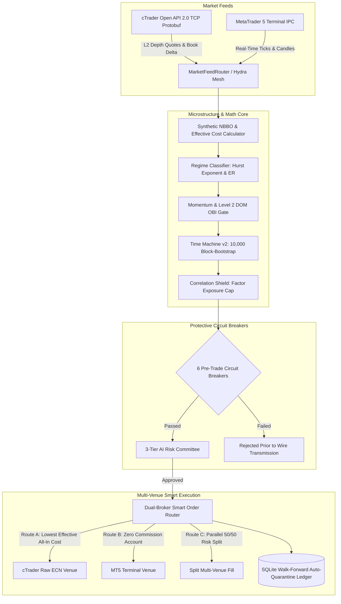
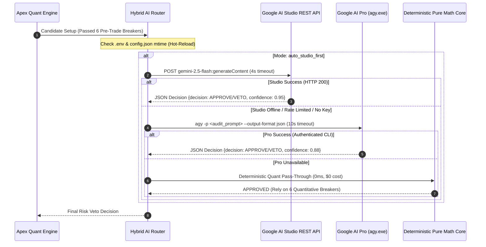
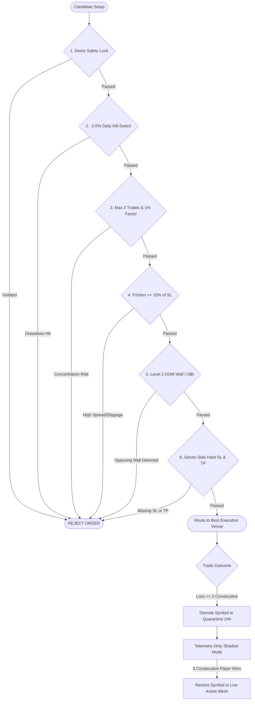

# PocketBot Apex — Flagship Dual-Edition Quantitative Algorithmic Trading System

PocketBot Apex is an institutional-grade, multi-venue quantitative algorithmic trading system engineered for MetaTrader 5 (MT5) and cTrader. It is structured as a **Dual-Edition Monorepo** providing two distinct production tiers:
1. **PocketBot v1 Classic (`v1-classic/`):** Lightweight, zero-configuration autonomous trading designed for beginners running a single MetaTrader 5 account.
2. **PocketBot Apex v2 Hydra SOR (`v2-apex/`):** Institutional multi-venue execution engine with an Active-Active Smart Order Router (SOR), full 251-symbol broker catalog auto-discovery across 7 asset classes, Level 2 Depth of Market (DOM) Order-Book Imbalance (OBI), 10,000-path stationary block-bootstrap simulations, and an event-driven 3-Tier AI Risk Committee.

---

## 🏛️ System Architecture: The Apex Hydra SOR

PocketBot Apex features the **"Apex Hydra" Active-Active Smart Order Router**, which consolidates pricing and liquidity from both cTrader Open API (Protobuf TCP) and MetaTrader 5 (IPC) into a single Synthetic National Best Bid and Offer (NBBO) mesh.

---

## 🌌 251-Symbol Two-Stage Universe Funnel & Smart Alias Mapper

PocketBot Apex dynamically queries the full broker catalog via MetaTrader 5 (`mt5.symbols_get()`) and cTrader Open API (`ProtoOASymbolsListReq`), classifying all tradable instruments into 7 asset classes:

| Asset Class | Symbols | Key Instruments & Coverage |
| :--- | :--- | :--- |
| **US Equities** | **109** | Tech giants (`NVDA`, `TSLA`, `AAPL`, `MSFT`, `AMZN`, `GOOGL`, `META`) + broad-market equities |
| **Forex** | **86** | Majors, minors, and exotic cross pairs (`EURUSD`, `GBPUSD`, `USDJPY`, `EURTRY`, `USDZAR`...) |
| **Indices** | **16** | `US500` (S&P 500), `NAS100` (Nasdaq), `US30` (Dow), `GER40` (DAX), `UK100` (FTSE), `JPN225`... |
| **Crypto** | **14** | `BTCUSD`, `ETHUSD`, `SOLUSD`, `LTCUSD`, `DOGEUSD`, `AVAXUSD`, `DOTUSD`... |
| **Metals** | **12** | Gold (`XAUUSD`, `XAUEUR`), Silver (`XAGUSD`), Platinum (`XPTUSD`), Palladium, Copper |
| **Commodities** | **11** | Arabica Coffee (`COFARA`), Corn, Cotton, Orange Juice (`OJ`), Soybeans, Sugar, Wheat |
| **Energy** | **3** | WTI Crude Oil (`XTIUSD`), Brent Crude Oil (`XBRUSD`), Natural Gas (`XNGUSD`) |

### Funnel Execution Workflow:
- **Stage A (Sub-Second Universe Sweep):** Filters symbols by market open/closed session, stale tick age, and spread friction ceiling ($\le 15\%$ of SL). Ranks active symbols by momentum and Kaufman Efficiency Ratio (ER) mover scores.
- **Stage B (Deep Quantitative Evaluation):** Top ranked movers enter the complete quant pipeline (Hurst regime classification $\to$ Momentum/DOM OBI gate $\to$ 10,000-Path Monte Carlo Time Machine $\to$ Institutional Factor Exposure Shield).
- **Expanded Correlation Shield:** Decomposes all 251 symbols into underlying factors (+base/-quote FX, Beta, single-stock factors `Stock_<Ticker>`) and enforces strict 1.0% single-factor risk caps.

---

## 🤖 3-Tier Hybrid AI Risk Veto Waterfall

High-frequency quantitative filters run at **$0 AI token cost**. The AI layer operates as an event-driven adversarial risk auditor, evaluating trades only when all quantitative barriers have been satisfied (~0–5 times/day):

---

## 🛡️ 6 Pre-Trade Circuit Breakers & Auto-Quarantine Engine

Every order is subjected to 6 hard pre-trade checks before entering the routing layer:

---

## 📊 Dual-Edition Monorepo Comparison

| Capability | PocketBot v1 Classic (`v1-classic/`) | PocketBot Apex v2 Hydra SOR (`v2-apex/`) |
| :--- | :--- | :--- |
| **Intended User** | Beginners, single MT5 account, zero-config | Prop traders, institutional quants, multi-broker |
| **Market Universe** | Fixed major FX & US tech symbols (5–10) | Full 251-symbol broker catalog auto-discovery (7 asset classes) |
| **Universe Scanner** | Single-symbol polling loop | 2-Stage Funnel (Stage A sweep $\to$ Stage B deep quant) |
| **Supported Venues** | MetaTrader 5 (Local IPC) | MT5 IPC + cTrader Open API Protobuf TCP (Active-Active) |
| **Execution Engine** | Single-venue direct routing with SL/TP | Synthetic NBBO Smart Order Router + 50/50 Risk Split |
| **Microstructure** | Candle impulse + ATR volatility filter | Full Level 2 Depth of Market (DOM) + Order-Book Imbalance (OBI) |
| **Friction Control** | Fixed spread filter | VWAP Depth Slippage Model + Liquidity Wall Detection |
| **Monte Carlo Engine** | Deterministic 2R Expectancy Model | 10,000-Path Stationary Block-Bootstrap Time Machine v2 |
| **Portfolio Shield** | Fixed 0.5% ($50) risk cap | Expanded Correlation Shield (251-symbol factor exposure cap) |
| **AI Risk Committee** | None ($0 token cost) | 3-Tier Waterfall + Apex Aegis 7-Shield Z3 SMT Firewall + Circadian Sleep-Wake Consolidation |
| **Telemetry & UI** | Console logging & command-line stats | WebSocket Chrome App Cockpit (`v2.4`) + Rich TUI + 100x Replay + Telegram Remote |
| **Database & Ledger** | JSON flat files (`orders.json`) | SQLite Auto-Quarantine Ledger (`WalkForwardLedgerDB`) |
| **Portability** | 1-Click portable `.bat` launchers | 1-Click portable `.bat` launchers + USB ready |

---

## 🚀 3-Step Non-Coder Quickstart

You do **not** need any coding experience to use PocketBot Apex.

1. **Download the Release:**
   Download `PocketBot_Apex_v2_Portable_Windows.zip` from [GitHub Releases](https://github.com/Keshuin0/pocketbot-apex/releases) and extract it anywhere on your computer (or USB pendrive).
2. **Run First-Time Setup:**
   Open the folder and double-click `0_FIRST_TIME_SETUP.bat`. It automatically verifies your system, installs 64-bit Python 3.12, creates a local `.venv`, installs all quantitative libraries (including `z3-solver` and `aiohttp`), runs 72 automated verification tests, and checks your MT5 connection.
3. **Start Autonomous Trading, Web Cockpit, or Live Drill:**
   Double-click `2_START_APEX_AUTO_DEMO.bat` for hands-free autonomous trading + Chrome App Cockpit, `4_APEX_LIVE_DASHBOARD.bat` to launch the live `v2.4` WebSocket Chrome App Cockpit + 100x Historical Replay, `8_REFRESH_AI_BRAIN.bat` for 1-click Circadian Sleep-Wake Consolidation, or `9_TEST_FULL_LIFECYCLE_NOW.bat` for a 60s live `0.01`-lot MT5 Demo lifecycle drill!

---

## 📐 Mathematical Profit Model: The 2R Edge

Every trade setup is engineered with a strict **2:1 Reward-to-Risk (2R)** ratio:
- **Risk ($1R$):** $0.50\%$ of account equity ($\$50.00$ on a $\$10,000$ account).
- **Target Reward ($2R$):** $1.00\%$ of account equity ($\$100.00$ on a $\$10,000$ account).

$$\text{Expectancy } E = (W \cdot 2.0) - ((1 - W) \cdot 1.0) = 3W - 1$$

With a baseline **$45\%$ win rate**:

$$E = (0.45 \cdot 2.0) - (0.55 \cdot 1.0) = +0.35R \text{ per trade}$$

Over 100 executed trades:

$$\text{Expected Value} = 100 \times (+0.35 \times \$50.00) = +\$1,750.00 \text{ (+17.5\% gain)}$$

Even in adverse market conditions where the win rate drops to **$38\%$**, the system remains mathematically profitable ($E = +0.14R$).

For the full mathematical derivation, Kelly fraction formulas, and drawdown proofs, see [docs/PROFIT_MATH_AND_RISK.md](docs/PROFIT_MATH_AND_RISK.md).

---

## 📚 Documentation & Guides

Explore the comprehensive documentation hub:
- 📖 **[Interactive Visual Manual](https://keshuin0.github.io/pocketbot-apex/)** (Zero-dependency, dark-mode visual manual)
- 🏛️ **[System Architecture Deep-Dive](docs/ARCHITECTURE.md)** (Twisted async core, Protobuf decoding, NBBO math)
- 📈 **[Profit Mathematics & Risk Model](docs/PROFIT_MATH_AND_RISK.md)** (2R expectancy, Kelly sizing, friction ceiling)
- 🔌 **[Broker Setup Guide (MT5 & cTrader)](docs/BROKER_SETUP_MT5_CTRADER.md)** (Algo trading setup, OAuth wizard)
- 📋 **[1-Page Desk Cheat Sheet](docs/DESK_CHEATSHEET.md)** (Printable desktop reference card)
- 🛠️ **[Troubleshooting Guide](docs/TROUBLESHOOTING.md)** (Resolutions for common errors and edge cases)

---

## 🔒 Safety Invariants & Demo Lock

1. **Hard-Locked Demo Default:** PocketBot Apex is hard-locked to Demo accounts by default. Live account routing will trigger an immediate runtime exception unless **BOTH**:
   - The `--unlock-live` CLI flag is explicitly passed at startup, **AND**
   - The environment variable `APEX_UNLOCK_LIVE=I_ACCEPT_REAL_RISK` is present.
2. **Server-Side SL & TP Mandatory:** Orders without valid server-side hard Stop-Loss and Take-Profit parameters are blocked before reaching the broker network socket.
3. **Zero Secrets in Repository:** Pre-commit and CI automated audits enforce zero credentials, zero API keys, and zero private paths.

---

## ⚖️ Legal & Financial Disclaimer

PocketBot Apex is an open-source quantitative research software provided under the MIT License for educational and algorithmic research purposes only. It is **not** financial, investment, or legal advice. Trading foreign exchange, CFDs, and digital assets involves substantial risk of loss and is not suitable for all investors. Never trade with capital you cannot afford to lose. Past or simulated performance is not indicative of future results.
