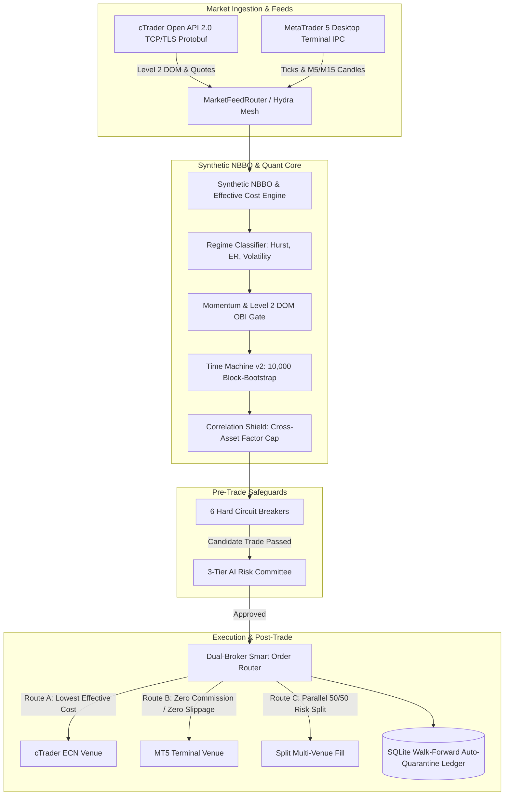
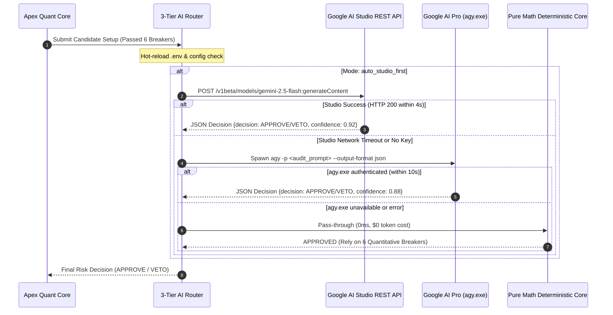

# PocketBot Apex — System Architecture & Engineering Deep-Dive

## 1. High-Level Architectural Vision

PocketBot Apex is an institutional-grade, multi-venue quantitative algorithmic trading engine designed for retail traders and prop firm participants. It implements an **Active-Active Smart Order Router (Hydra SOR)** that bridges two major trading platforms: **MetaTrader 5 (MT5)** via low-latency local Inter-Process Communication (IPC) and **cTrader Open API** via high-throughput Google Protocol Buffers (Protobuf) over asynchronous TCP/TLS.

The architecture enforces a strict boundary between two operational planes:
1. **$0 Real-Time Hot Path (Twisted Python & Pure Math):** Handles 100% of high-frequency market data ingestion, synthetic National Best Bid and Offer (NBBO) aggregation, Level 2 Depth of Market (DOM) Order-Book Imbalance (OBI), 10,000-run Monte Carlo stationary block-bootstrap simulations, and sub-millisecond order routing.
2. **Event-Driven AI Risk Committee (Gemini API & Google AI Pro):** Operates on an adversarial check-and-balance principle, invoked *only* when a candidate trade has already satisfied all quantitative and microstructure barriers (typically 0–5 times per trading session).

---

## 2. Market Ingestion Subsystems

### 2.1 cTrader Open API Protobuf Streaming
The cTrader integration operates over persistent TLS sockets connecting to Spotware's low-latency proxy servers (`live.ctraderapi.com:5035` or `demo.ctraderapi.com:5035`). It implements Twisted asynchronous streaming with framed protobuf message handlers:
- **`ProtoOAApplicationAuthReq` & `ProtoOAAccountAuthReq`:** Handshake protocol authorizing the application Client ID/Secret and trading account token.
- **`ProtoOASubscribeDepthQuotesReq`:** Subscribes to full Level 2 Depth of Market price ladders.
- **`ProtoOADepthEvent`:** Real-time push stream delivering incremental order book quote additions, volume revisions, and quote deletions.
- **`ProtoOATrendbarDelta`:** Decodes delta-encoded incremental OHLC candle updates into complete historical sequences.

### 2.2 MetaTrader 5 Inter-Process Communication (IPC)
The MT5 subsystem interfaces with MetaTrader 5 terminals running locally on 64-bit Windows:
- Uses shared memory memory-mapped buffers and Windows named pipes provided by `package:MetaTrader5`.
- Implements automated symbol specification parsing (`digits`, `point`, `volume_min`, `volume_step`, `trade_tick_value`).
- Features **Automated Filling Mode Detection**: Queries `symbol_info.filling_mode` to select `SYMBOL_FILLING_FOK`, `SYMBOL_FILLING_IOC`, or `SYMBOL_FILLING_RETURN`, eliminating broker execution rejects.
- Fallback to **Paper-Shadow Mode**: If automated trading is disabled by the broker server or terminal settings, orders transition into paper execution without interrupting market telemetry.

---

## 3. Microstructure & Quantitative Math Engine

### 3.1 Order-Book Imbalance (OBI)
Order-Book Imbalance quantifies the directional buying vs. selling pressure across the top $N$ resting book levels:

$$OBI = \frac{\sum_{i=1}^{N} V_{bid, i} - \sum_{i=1}^{N} V_{ask, i}}{\sum_{i=1}^{N} V_{bid, i} + \sum_{i=1}^{N} V_{ask, i}} \in [-1.0, +1.0]$$

- Long trades require $OBI \ge +0.15$.
- Short trades require $OBI \le -0.15$.
- Entries are immediately vetoed if an opposing **Liquidity Wall** ($V_i \ge 3.0 \times \text{Median Volume}$) rests within $1.5 \times \text{ATR}$ of the market price.

### 3.2 VWAP Depth Slippage & Effective All-In Cost
Traditional retail systems only consider quoted top-of-book spread. PocketBot Apex calculates the true **Effective All-In Cost**:

$$\text{Effective Cost} = \text{Raw Spread} + \text{Round-Turn Commission} + \text{VWAP DOM Depth Slippage} + \text{Latency Penalty}$$

The Volume-Weighted Average Price (VWAP) for an order of size $Q$ units swept through book levels $k=1 \dots K$:

$$\text{VWAP}_{fill} = \frac{\sum_{k=1}^{K} P_k \cdot q_k}{Q}, \quad \text{where } \sum_{k=1}^{K} q_k = Q$$

$$\text{Slippage Pips} = \frac{|\text{VWAP}_{fill} - P_{top}|}{\text{Pip Size}}$$

If total effective cost exceeds $15\%$ of the $1R$ stop distance, the trade is rejected prior to routing.

### 3.3 Rolling Hurst Exponent & Market Regime Classification
Market regimes are classified continuously using rolling rescaled range analysis ($R/S$):

$$H = \frac{\log(R/S)}{\log(N)}$$

- **$H > 0.55$ (Persistent / Trending Expansion):** Momentum breakout strategies active.
- **$H < 0.45$ (Anti-Persistent / Mean-Reverting Chop):** Breakout entries auto-blocked to prevent false breakout bleed.
- **Volatility Shock Lockout:** Triggered when current spread exceeds $1.5\times$ the rolling median spread or tick velocity spikes $> 4\sigma$.

### 3.4 Time Machine v2: 10,000-Path Stationary Block Bootstrap
Before any trade is routed, historical trade returns undergo 10,000 resampled simulations with block-length preservation:
- Deducts estimated broker commission and simulated 1.5-pip adverse slippage on every path.
- Computes empirical 95% Value-at-Risk ($\text{VaR}_{95}$) and Expected Shortfall ($\text{CVaR}_{95}$).
- Scales position size using fractional Kelly criterion capped at $0.50\%$ of account equity.

---

## 4. 3-Tier Hybrid AI Risk Veto Waterfall

To guarantee $0 unnecessary token costs and zero latency during high-frequency scans, the AI layer is strictly decoupled:

1. **Google AI Studio REST (`studio_api`):** Directly invokes Gemini Flash via API key with a 4-second hard timeout.
2. **Google AI Pro CLI (`agy_pro`):** Subprocess invoke of authenticated CLI tool with automated ANSI stripping on Windows non-TTY streams.
3. **Pure Math Engine (`pure_math`):** Zero-latency deterministic fallback that approves setups based purely on quantitative indicators and circuit breakers.

---

## 5. Circuit Breakers & Auto-Quarantine Ledger

The execution router enforces **6 Non-Negotiable Pre-Trade Circuit Breakers**:
1. **Demo Account Safety Lock:** Hardcoded runtime exception if live routing is attempted without `--unlock-live` flag and `APEX_UNLOCK_LIVE=I_ACCEPT_REAL_RISK` environment variable.
2. **-2.0% Daily Drawdown Kill-Switch:** Evaluates closed plus floating P/L. Halts all new orders if drawdown reaches $2.0\%$ of starting equity.
3. **Max 2 Concurrent Trades & 1.0% Factor Cap:** Prevents portfolio over-leverage.
4. **All-In Spread & Slippage Cap:** Spread + VWAP slippage must be $\le 15\%$ of SL distance.
5. **Level 2 DOM Wall / OBI Gate:** Verifies positive liquidity alignment on cTrader.
6. **Mandatory Server-Side SL & TP:** Verifies server-side orders include protective stops before transmission.

### Auto-Quarantine SQLite Recovery Loop
Symbols that experience consecutive losses or extreme slippage are recorded in `WalkForwardLedgerDB`:
- 2 consecutive losses demote the symbol to **Quarantine** status for 24 hours.
- While in quarantine, live execution is suppressed while paper telemetry monitors performance.
- When paper tracking records 3 consecutive winning setups post-quarantine, the symbol is restored to active routing.
